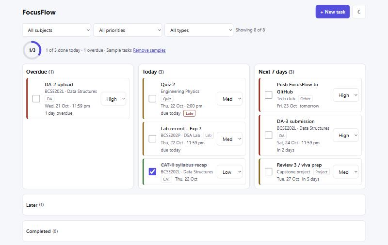
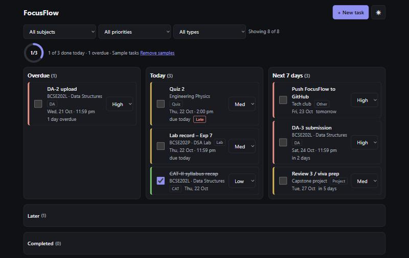
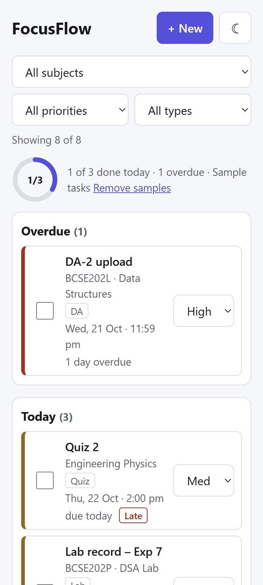

# FocusFlow

Daily view of your DAs, labs, quizzes and FATs, built for VIT students around the DA / CAT / FAT cycle.
Not affiliated with VIT.

> **Live demo: https://focus-flow-plum-omega.vercel.app**



<p>
  
  
</p>

## Features

**Base requirements**
- [x] Create / edit / delete tasks: title, subject, type, due date (+ optional time), priority, done
- [x] Dashboard: Overdue, Today, Next 7 days, plus collapsed Later and Completed
- [x] Filter by subject, priority and type
- [x] Persistence in `localStorage` with backup of damaged data, cross-tab sync, JSON export/import, undo

**Brownie points**
- [x] Progress ring for today's completion (counts all of today's tasks, ignores filters)
- [x] Dark/light theme: follows the OS until you pick one, saved, applied before first paint so there is no flash
- [x] Responsive mobile layout: 1 → 2 → 3 columns, no horizontal scroll from 320 px, 44 px touch targets
- [x] Keyboard shortcuts with a `?` help dialog and an off switch (see below)
- [x] Drag-and-drop priority board: High / Med / Low columns, works with mouse, touch and keyboard

## Run

```bash
npm ci
npm run dev      # http://localhost:5173
npm test         # date, bucket, reducer and persistence tests
npm run build
```

## Keyboard shortcuts

| Key | Action |
|---|---|
| `N` | New task |
| `/` | Jump to the subject filter |
| `D` / `B` | Dashboard / priority board |
| `C` | Clear filters |
| `T` | Toggle theme |
| `?` | Help (includes the switch to turn single-key shortcuts off) |

Shortcuts are ignored while typing in a field, with Ctrl/Cmd/Alt held, while a dialog is open and mid-drag. On the board, focus a card's ⠿ handle, press `Space` to pick it up, any arrow key to jump to the next or previous column, `Space` to drop, `Esc` to cancel. Every card also has a priority dropdown, so dragging is never the only way to change priority.

## State management

**Source of truth.** One `tasks: Task[]` held by `useReducer` in `App.tsx`. All logic lives in React-free `src/store.ts`, which is unit-tested with `node:test`.

**Actions.** Five: `add`, `patch`, `remove`, `replace` (other tab, remove samples), `merge` (import). The reducer is pure; ids, trimming and "now" are resolved before dispatch, so StrictMode's double-run is harmless. Undo is just the inverse action kept in the toast.

**Derived, never stored.** Overdue / Today / Next 7 days, the filtered list, the "x of y done today" summary and the subject list are all recomputed from `(tasks, filters, now)` on every render, so they cannot drift out of sync. `now` ticks every 60 s and when the tab is shown again, so the dashboard rolls over at midnight.

**UI state** (filters, view, open dialog, toast, banners) is plain `useState` and not persisted. The board has no state of its own: a drop dispatches the same `patch` as the priority dropdown, and column order comes from the due-date sort, so there is no `order` field to keep in sync. Theme and shortcut preferences live outside React (`localStorage` plus a `data-theme` attribute set before first paint).

**Persistence.** One versioned key, `focusflow:data` (`{version, tasks}`). Every read (load, import, other-tab `storage` event) goes through `parse`, which validates each task and drops bad rows. Damaged data is copied to a backup key before anything is overwritten; if even the backup fails, saving pauses until the user resumes. A failed save (quota) shows a banner instead of losing the screen. Writes are skipped when the string is unchanged, which stops tab-to-tab echo. If storage is blocked the app runs in memory and says so.

```
UI event ─dispatch(Action)→ reducer → tasks ─┬→ selectors(tasks, filters, now) → render
                                             └→ effect: save() → localStorage['focusflow:data']
other tab: 'storage' event → parse() → dispatch(replace)
```

**Why not Redux, Zustand or Context?** One owner and five actions; `dispatch` goes at most three components deep.

## Accessibility

- Lighthouse (mobile, live site): Performance 99, Accessibility 100, Best Practices 100, SEO 100.
- Checked with accesslint (0 violations on the dashboard and the board) and a keyboard-only run: skip link, logical tab order, visible focus, `<dialog>` with Escape.
- View and filters are kept in the URL, so `?view=board&priority=high` opens straight to that view.
- After ticking, editing or deleting a task, focus stays on it or moves to the section it left, and a status message announces what happened (with Undo).
- All text meets WCAG AA contrast in both themes; priority is shown as text, not only colour.
- The progress ring is a `progressbar` with a readable value ("1 of 3 done"); animation is off under reduced motion.

## Limits

- Data lives in one browser. Use Export to back up or move it.
- Two open tabs sync, but the last write wins.
- Safari may clear site data for sites you haven't visited in a while; export if that matters.

## Date rules

Dates are local `YYYY-MM-DD` strings, never `toISOString()` or `new Date('YYYY-MM-DD')` (both are UTC and give yesterday between 00:00 and 05:30 IST). Today's tasks stay in Today even when done; open tasks before today are Overdue; open tasks up to 7 days out are Next 7 days.
